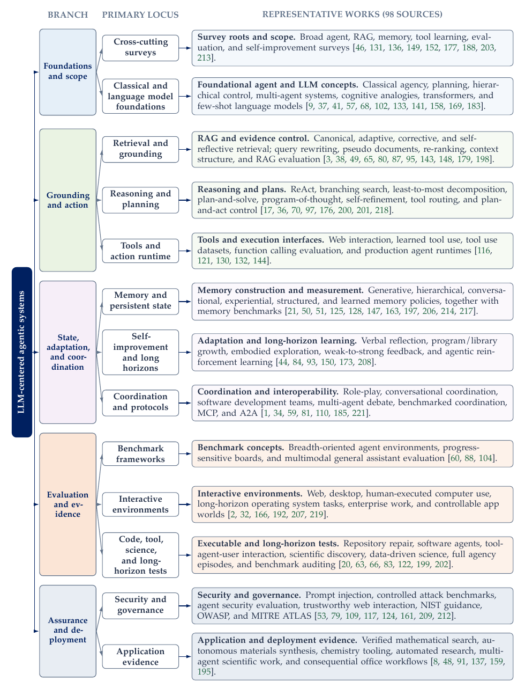

# LLMs in Modern Agentic Systems

**A Systems Survey**

<p align="center">
  <a href="https://github.com/Xpounder-com/llms-in-modern-agentic-systems"> <strong>LLMs in Modern Agentic Systems</strong></a>
  &nbsp;&nbsp;&nbsp;&nbsp;
  <a href="https://xpounder-com.github.io/llms-in-modern-agentic-systems/"> <strong>Project Page</strong></a>
</p>

[](https://xpounder-com.github.io/llms-in-modern-agentic-systems/)
[](https://xpounder-com.github.io/llms-in-modern-agentic-systems/llms-in-modern-agentic-systems.pdf)
[](#literature-atlas)
[](LITERATURE.md)
[](https://github.com/Xpounder-com/llms-in-modern-agentic-systems/actions/workflows/pages.yml)

This repository accompanies **LLMs in Modern Agentic Systems: A Systems Survey**, a comprehensive account of how language models become components of systems that retrieve evidence, maintain state, invoke tools, coordinate specialized components, and act over extended horizons.

The paper uses **LLM-centered agentic systems** as an umbrella term while keeping five operational forms distinct: LLM applications, retrieval-augmented generation, developer-authored workflows, bounded agents, and multi-agent systems.

[Read the paper](https://xpounder-com.github.io/llms-in-modern-agentic-systems/llms-in-modern-agentic-systems.pdf) · [Narrative guide](https://xpounder-com.github.io/llms-in-modern-agentic-systems/narrative/) · [Literature index](LITERATURE.md)

## Contents

- [Central argument](#central-argument)
- [Definition and scope](#definition-and-scope)
- [Operational taxonomy](#operational-taxonomy)
- [Literature atlas](#literature-atlas)
- [How to read the survey](#how-to-read-the-survey)
- [Project materials](#project-materials)
- [Contributing](#contributing)
- [Citation](#citation)

## Central argument

Fluent generation is not dependable autonomy. Reliable agency is a systems problem: heterogeneous evidence must be transformed into bounded, reviewable, and verifiably completed effects through explicit state, typed data structures, action contracts, permissions, verification, and traceability.

The survey develops this argument across six interacting layers:

1. Grounding and perception
2. Memory and state
3. Reasoning and planning
4. Action and tool interfaces
5. Coordination and interoperability
6. Safety, governance, and observability

Across these layers, four distinctions organize the evidence: **execution form**, **functional layer**, **adaptation locus**, and **evidence lens**.

## Definition and scope

An **agent** is a system in which a model helps choose the next action from a bounded action space using a goal, current state, and observations. An **agentic system** is the surrounding socio-technical system of agents, tools, policies, memory, evaluators, and human oversight.

The broader **LLM-centered agentic system** may contain fixed retrieval and workflow components. The umbrella is intentionally broad; the term *agent* is reserved for systems in which a model adaptively participates in choosing the next action.

## Operational taxonomy

| System form | Control flow | State and authority |
| --- | --- | --- |
| **LLM application** | One invocation or a fixed sequence | Context-local state; control remains outside the model |
| **RAG application** | Fixed retrieve, construct-context, generate pipeline | External evidence access; retrieval policy is largely predetermined |
| **LLM workflow** | Developer-authored graph, state machine, or process | May include tools, retries, and persistent state; most branching is explicit |
| **Bounded agent** | The model selects permitted actions and may revise its plan | Explicit task state, tools, budgets, stopping rules, and permission boundaries |
| **Multi-agent system** | Multiple bounded agents exchange tasks, evidence, or control | Distributed state, role-specific tools, coordination, and conflict resolution |

The practical rule is to use the least autonomy that solves the task: RAG for attributable evidence, workflows for predictable control, bounded agents for uncertain but verifiable work, and multi-agent systems only when distinct roles create a measurable advantage.

## Literature atlas

[](docs/assets/literature-atlas.png)

Figure 2 assigns **98 representative works** to one primary locus. This identifies the work’s principal contribution rather than an exclusive category; many methods span multiple layers. The complete bibliography contains **222 cited sources**.

- [Browse the taxonomy-aligned literature index](LITERATURE.md)
- [Inspect the core bibliography](refs.bib)
- [Inspect the expanded bibliography](expanded-refs.bib)

## How to read the survey

| Reader | Suggested route |
| --- | --- |
| **Five-minute orientation** | Follow the [narrative guide](https://xpounder-com.github.io/llms-in-modern-agentic-systems/narrative/) from system boundary to accountable action |
| **System builder** | Start with [architectures, state, planning, tools, and interoperability](4-architecture.tex) |
| **RAG researcher** | Start with [retrieval, evidence control, and the transition to agentic retrieval](2-rag.tex) |
| **Evaluator or reviewer** | Start with [metrics, benchmarks, protocols, and validity](5-evaluating.tex) |
| **Safety or governance reader** | Start with [authority, threats, oversight, and incident response](6-safety-governance.tex) |
| **Deployment reader** | Start with [evidence from deployed and experimental systems](6-applications.tex) |

## Project materials

- [`0-main.tex`](0-main.tex) — paper entry point and current abstract
- [`1-intro.tex`](1-intro.tex) — operational definitions, systems lens, and literature atlas
- [`2-rag.tex`](2-rag.tex) — RAG and agentic retrieval
- [`3-agents-foundation.tex`](3-agents-foundation.tex) — classical and language-model agent foundations
- [`4-architecture.tex`](4-architecture.tex) — architectures, memory, planning, tools, adaptation, and coordination
- [`5-evaluating.tex`](5-evaluating.tex) — metrics, protocols, benchmarks, and validity
- [`6-safety-governance.tex`](6-safety-governance.tex) — reliability, security, and governance
- [`6-applications.tex`](6-applications.tex) — application and deployment evidence
- [`7-conclusion.tex`](7-conclusion.tex) — open problems and conclusion
- [`LITERATURE.md`](LITERATURE.md) — 98 representative works aligned to Figure 2
- [`CITATION.bib`](CITATION.bib) — citation metadata for the current anonymized manuscript
- [`refs.bib`](refs.bib) and [`expanded-refs.bib`](expanded-refs.bib) — 222 bibliography records
- [`paper/`](paper/) — current compiled survey PDF
- [`docs/`](docs/) — deployed GitHub Pages project hub

The checked-in PDF is the current **104-page, Overleaf-verified manuscript**. Temporary LaTeX build products are excluded from the public release workflow.

## Contributing

Corrections and additions are welcome. Use the issue templates to:

- suggest a missing paper or benchmark;
- report citation metadata or a broken link;
- challenge a taxonomy placement;
- report a paper, figure, table, or website correction.

Please read [CONTRIBUTING.md](CONTRIBUTING.md) before opening a pull request.

## Citation

The current public manuscript is anonymized. Update the author and archival fields when the public preprint is released.

```bibtex
@misc{anonymous2026llmsmodernagenticsystems,
  title  = {LLMs in Modern Agentic Systems: A Systems Survey},
  author = {Anonymous Author(s)},
  year   = {2026},
  note   = {Anonymized survey manuscript},
  url    = {https://xpounder-com.github.io/llms-in-modern-agentic-systems/}
}
```

## Status

Research cutoff: **July 2026**. Current public artifact: **anonymized 104-page survey manuscript with 222 cited sources**.
